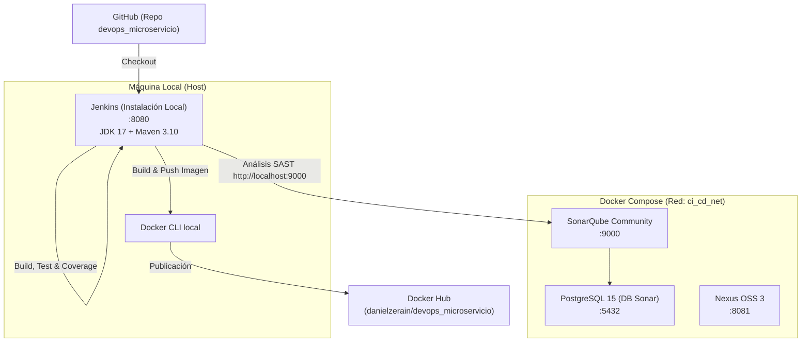
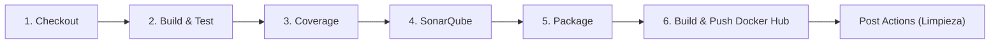
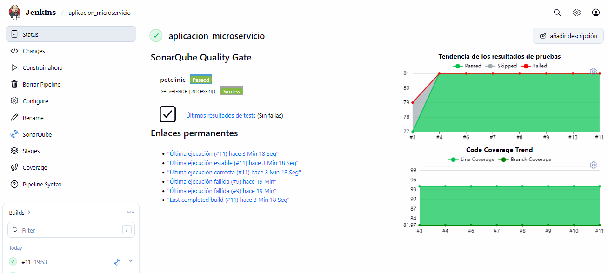
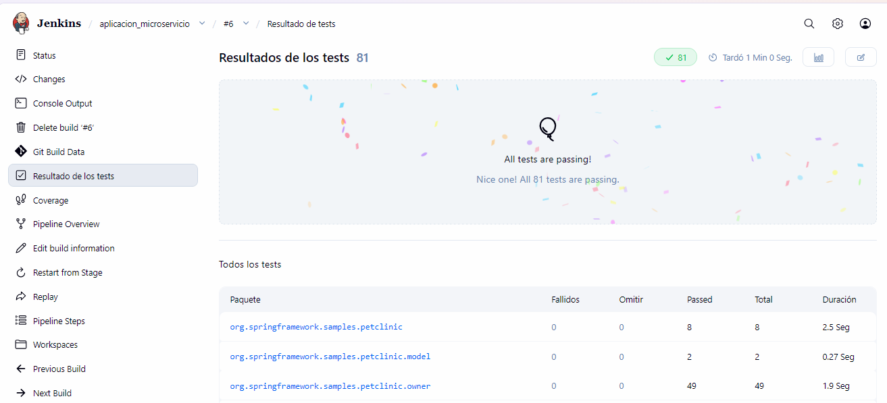
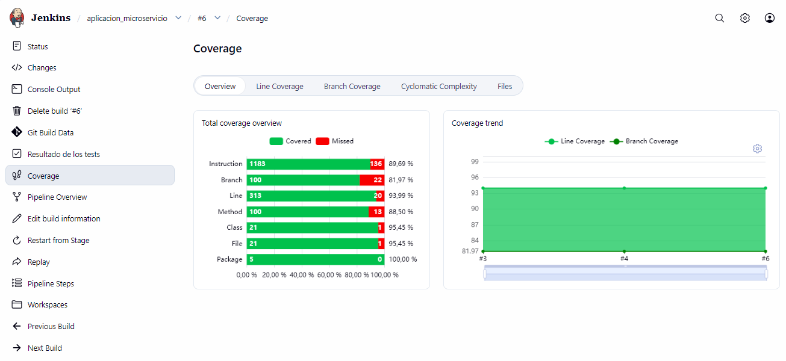
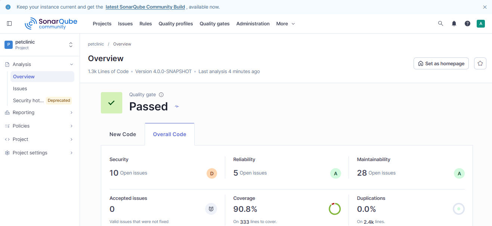
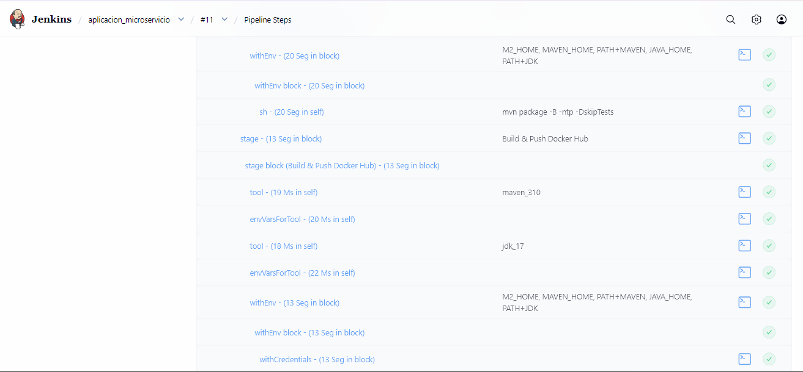
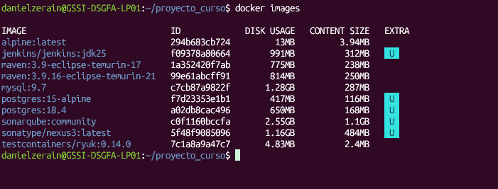
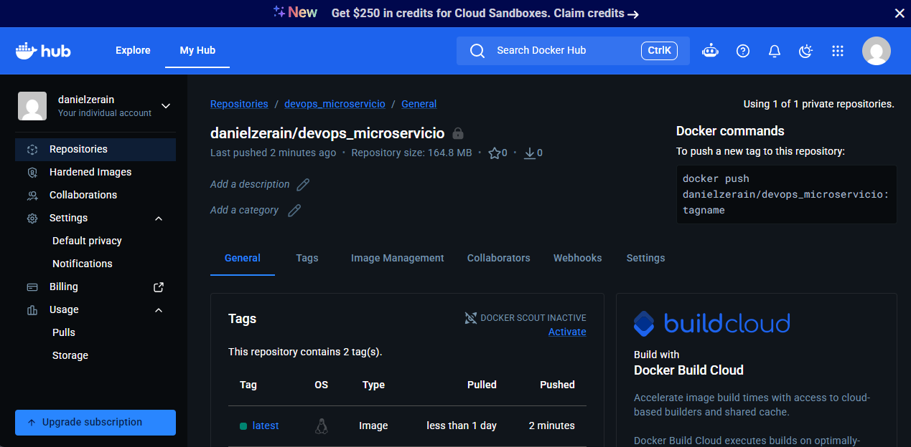

# Curso: DevSecOps / DevOps Engineer
# Trabajo Práctico: Pipeline CI/CD con Jenkins para Microservicio

**Autor:** Daniel Zerain Medinaceli  
**Repositorio:** [danielzerain/devops_microservicio](https://github.com/danielzerain/devops_microservicio)  
**Rama principal:** `main`  
**Tecnologías:** Jenkins (Pipeline Declarativo en Host Local), Docker & Docker Compose, Java 17, Apache Maven, JUnit, JaCoCo, SonarQube Community, Sonatype Nexus 3, PostgreSQL, Docker Hub.

---

## 1. Arquitectura del Entorno y Herramientas

La solución divide la infraestructura en dos capas:
1. **Jenkins instalado directamente en local (Host):** Orquesta el ciclo de vida del pipeline, interactúa con el CLI de Docker del host y administra el JDK 17 y Maven 3.10.
2. **Herramientas de apoyo en Docker:** Desplegadas mediante Docker Compose a través del archivo [`proyecto/Compose.yaml`](proyecto/Compose.yaml) en una red propia (`ci_cd_network`).



---

### 1.1 Definición de Docker Compose ([`proyecto/Compose.yaml`](proyecto/Compose.yaml))

Las herramientas de apoyo están definidas en la carpeta `proyecto/`:

```yaml
services:
  nexus:
    image: sonatype/nexus3:latest
    container_name: nexus_server
    ports:
      - "8081:8081"
    environment:
      - TZ=America/La_Paz
      - INSTALL4J_ADD_VM_PARAMS=-Xms1200m -Xmx1200m -XX:MaxDirectMemorySize=1024m
    volumes:
      - nexus_data:/nexus-data
    networks:
      - ci_cd_net

  sonarqube:
    image: sonarqube:community
    container_name: sonarqube
    depends_on:
      db:
        condition: service_healthy
    ports:
      - "9000:9000"
    environment:
      - SONAR_JDBC_URL=jdbc:postgresql://db:5432/sonar
      - SONAR_JDBC_USERNAME=sonar
      - SONAR_JDBC_PASSWORD=sonar_secure_password
    volumes:
      - sonarqube_data:/opt/sonarqube/data
      - sonarqube_extensions:/opt/sonarqube/extensions
      - sonarqube_logs:/opt/sonarqube/logs
    ulimits:
      nofile:
        soft: 65536
        hard: 65536
    networks:
      - ci_cd_net

  db:
    image: postgres:15-alpine
    container_name: sonarqube_db
    environment:
      - POSTGRES_USER=sonar
      - POSTGRES_PASSWORD=sonar_secure_password
      - POSTGRES_DB=sonar
    volumes:
      - postgresql_data:/var/lib/postgresql/data
    healthcheck:
      test: ["CMD-SHELL", "pg_isready -U sonar -d sonar"]
      interval: 10s
      timeout: 5s
      retries: 5
    networks:
      - ci_cd_net

networks:
  ci_cd_net:
    name: ci_cd_network
    driver: bridge

volumes:
  nexus_data:
  sonarqube_data:
  sonarqube_extensions:
  sonarqube_logs:
  postgresql_data:
```

#### Descripción de los Servicios Contenerizados

| Servicio | Contenedor | Puerto Expuesto | Descripción |
| :--- | :--- | :--- | :--- |
| **Nexus 3** | `nexus_server` | `8081:8081` | Repositorio para gestión de artefactos y binarios (`.jar`). Configurado con parámetros de memoria JVM (`-Xms1200m -Xmx1200m`). |
| **SonarQube** | `sonarqube` | `9000:9000` | Plataforma de inspección continua de código (calidad, vulnerabilidades y code smells). |
| **PostgreSQL** | `sonarqube_db` | Interno (`5432`) | Base de datos relacional para persistencia de proyectos en SonarQube con comprobación de estado (`healthcheck`). |

#### Comandos para gestión del entorno Docker:
```bash
# Iniciar servicios desde la raíz del proyecto
docker compose -f proyecto/Compose.yaml up -d

# Ver estado de los contenedores
docker compose -f proyecto/Compose.yaml ps

# Detener los servicios
docker compose -f proyecto/Compose.yaml down
```

---

## 2. Descripción General del Pipeline ([`proyecto/Jenkinsfile`](proyecto/Jenkinsfile))

El pipeline se encuentra ubicado en [`proyecto/Jenkinsfile`](proyecto/Jenkinsfile) y está escrito en sintaxis **Declarative Pipeline**:

```groovy
pipeline {
    agent any

    tools {
        maven 'maven_310'
        jdk 'jdk_17'
    }

    environment {
        HOME = "${WORKSPACE}"
        JAVA_HOME = "${tool 'jdk_17'}"
        PATH = "${JAVA_HOME}/bin:${env.PATH}"
        IMAGE_NAME = 'danielzerain/devops_microservicio'
        IMAGE_TAG = "${BUILD_NUMBER}"
        DOCKER_HUB_REPOSITORY = 'dockerhub-credentials'
    }
    ...
```

### Configuración Global y Variables de Entorno
* **`agent any`**: Se ejecuta en el agente local de Jenkins.
* **`tools`**:
  * `maven 'maven_310'`: Versión de Apache Maven configurada en las herramientas globales de Jenkins.
  * `jdk 'jdk_17'`: JDK 17 utilizado para la compilación y ejecución del microservicio.
* **`environment`**:
  * `HOME = "${WORKSPACE}"`: Delimita el directorio personal al espacio de trabajo del build.
  * `JAVA_HOME` y `PATH`: Garantizan la prioridad de Java 17 para la ejecución de comandos de Maven y scripts.
  * `IMAGE_NAME = 'danielzerain/devops_microservicio'`: Nombre del repositorio en Docker Hub.
  * `IMAGE_TAG = "${BUILD_NUMBER}"`: Tag incremental e inmutable generado por cada build de Jenkins.
  * `DOCKER_HUB_REPOSITORY = 'dockerhub-credentials'`: Identificador de las credenciales de Docker Hub en Jenkins.

---

## 3. Descripción Detallada de las Fases del Pipeline (Stages)





### Stage 1: Checkout
```groovy
stage('Checkout') {
    steps {
        git branch: 'main', url: 'https://github.com/danielzerain/devops_microservicio.git'
    }
}
```
* **Propósito:** Clona la rama `main` del repositorio remoto en GitHub hacia el workspace local del job en Jenkins.

---

### Stage 2: Build & Test
```groovy
stage('Build & Test') {
    steps {
        sh 'mvn clean test -B -ntp'
    }
    post {
        always {
            junit testResults: '**/target/surefire-reports/*.xml', allowEmptyResults: true
        }
    }
}
```
* **Propósito:** Compila las clases del proyecto y ejecuta todas las pruebas unitarias.
* **Banderas de Maven:**
  * `-B` (*Batch Mode*): Ejecución no interactiva pensada para integración continua.
  * `-ntp` (*No Transfer Progress*): Omite mensajes repetitivos de descarga de artefactos, optimizando la visualización de logs.
* **Post-Acción (`always`):** Publica los resultados generados por el plugin Surefire (`target/surefire-reports/*.xml`) para registrar métricas de tests aprobados/fallidos en la interfaz de Jenkins.



---

### Stage 3: Coverage
```groovy
stage('Coverage') {
    steps {
        sh 'mvn jacoco:report -B -ntp'
    }
    post {
        success {
            recordCoverage(tools: [[parser: 'JACOCO']])
        }
    }
}
```
* **Propósito:** Genera el reporte de cobertura de código mediante **JaCoCo**.
* **Post-Acción (`success`):** Almacena y grafica las métricas históricas de cobertura de código (líneas, ramas y métodos) usando el plugin *Code Coverage* de Jenkins.



---

### Stage 4: SonarQube
```groovy
stage('SonarQube') {
    steps {
        withSonarQubeEnv('sonarqube'){
            sh 'env | sort'
            script {
                sh 'mvn org.sonarsource.scanner.maven:sonar-maven-plugin:sonar'
            }
        }
    }
}
```
* **Propósito:** Inspección estática de código (SAST) para detectar vulnerabilidades, code smells, bugs y deuda técnica.
* **Integración:**
  * `withSonarQubeEnv('sonarqube')`: Inyecta la variable de entorno con la URL (`http://localhost:9000`) y el token del servidor SonarQube configurado en Jenkins.
  * Ejecuta el scanner de SonarQube mediante Maven para transferir el análisis y los reportes de JaCoCo al servidor SonarQube.



---

### Stage 5: Package
```groovy
stage('Package') {
    steps {
        sh 'mvn package -B -ntp -DskipTests'
    }
}
```
* **Propósito:** Construye el archivo empaquetado final (`.jar` ejecutable de Spring Boot) en el directorio `target/`.
* **Optimización:** `-DskipTests` evita repetir la ejecución de pruebas unitarias que ya fueron validadas y reportadas en las fases previas, optimizando los tiempos del ciclo de CI/CD.



---

### Stage 6: Build & Push Docker Hub
```groovy
stage('Build & Push Docker Hub') {
    steps {
        withCredentials([usernamePassword(
            credentialsId: "${DOCKER_HUB_REPOSITORY}",
            usernameVariable: 'DOCKER_USER',
            passwordVariable: 'DOCKER_PASS'
        )]) {
            sh '''
                echo "$DOCKER_PASS" | docker login -u "$DOCKER_USER" --password-stdin
                docker build -t ${IMAGE_NAME}:${IMAGE_TAG} -t ${IMAGE_NAME}:latest .
                docker push ${IMAGE_NAME}:${IMAGE_TAG}
                docker push ${IMAGE_NAME}:latest
                docker logout
            '''
        }
    }
}
```
* **Propósito:** Empaqueta el microservicio en una imagen Docker y la publica en Docker Hub.
* **Pasos ejecutados:**
  1. `withCredentials`: Gestiona de forma segura el usuario y token/contraseña de Docker Hub sin exponerlos en logs.
  2. `docker login --password-stdin`: Inicio de sesión seguro en el registro de contenedores.
  3. `docker build`: Construye la imagen a partir del [`Dockerfile`](Dockerfile) ubicado en la raíz del proyecto, asignando dos tags: número de build (`${BUILD_NUMBER}`) y `latest`.
  4. `docker push`: Publica ambas etiquetas en el registro público.
  5. `docker logout`: Cierra la sesión activa en el host local.




---

## 4. Post-Actions Globales (Mantenimiento)

```groovy
post {
    always {
        sh '''
            docker rmi ${IMAGE_NAME}:${IMAGE_TAG} ${IMAGE_NAME}:latest 2>/dev/null || true
        '''
    }
}
```

* **Higiene del Host:** El bloque `post { always { ... } }` se ejecuta de forma incondicional al finalizar el pipeline.
* Elimina las imágenes locales recién creadas (`docker rmi`) una vez publicadas en Docker Hub, impidiendo el crecimiento descontrolado de almacenamiento en disco en la máquina host.

---

## 5. Configuración Requerida en Jenkins Local

Para ejecutar el pipeline en el servidor Jenkins local (`http://localhost:8080`), se deben configurar los siguientes elementos:

1. **Herramientas Globales (*Manage Jenkins -> Tools*):**
   * **JDK:** `jdk_17` apuntando a Java 17.
   * **Maven:** `maven_310` apuntando a la instalación de Maven 3.10.
2. **Credenciales (*Manage Jenkins -> Credentials*):**
   * **ID:** `dockerhub-credentials`
   * **Tipo:** *Username with password*
   * **Valores:** Usuario y Access Token / Contraseña de Docker Hub.
3. **Servidor SonarQube (*Manage Jenkins -> System -> SonarQube servers*):**
   * **Nombre:** `sonarqube`
   * **URL:** `http://localhost:9000` (apunta al contenedor de SonarQube expuesto en el puerto 9000 del host).
   * **Token de autenticación:** Token generado desde SonarQube (*Security -> Users -> Tokens*).
